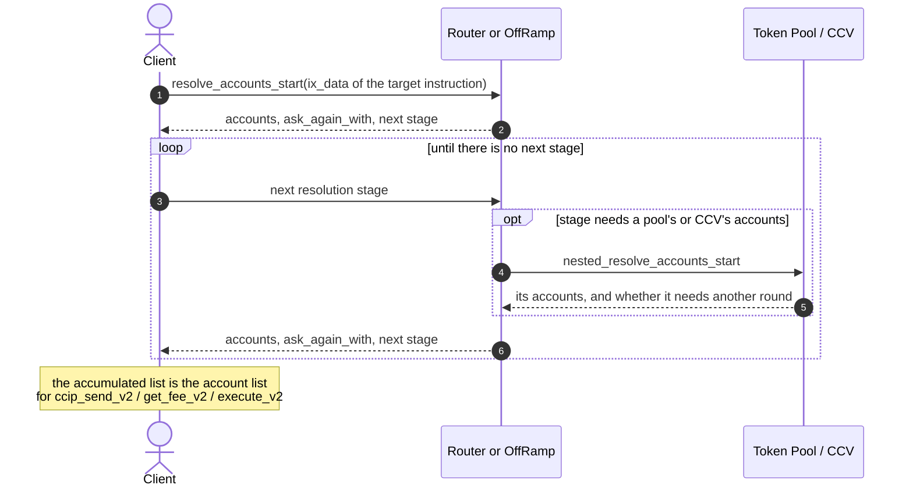
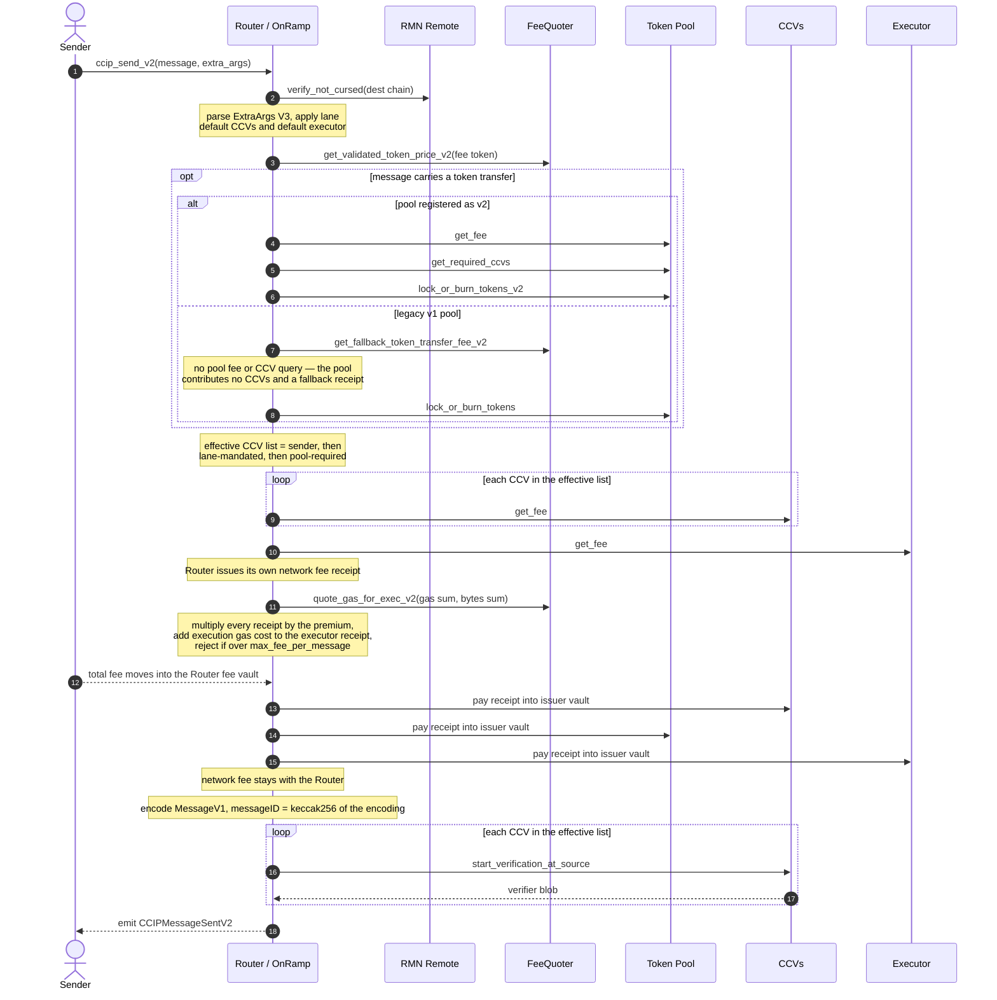
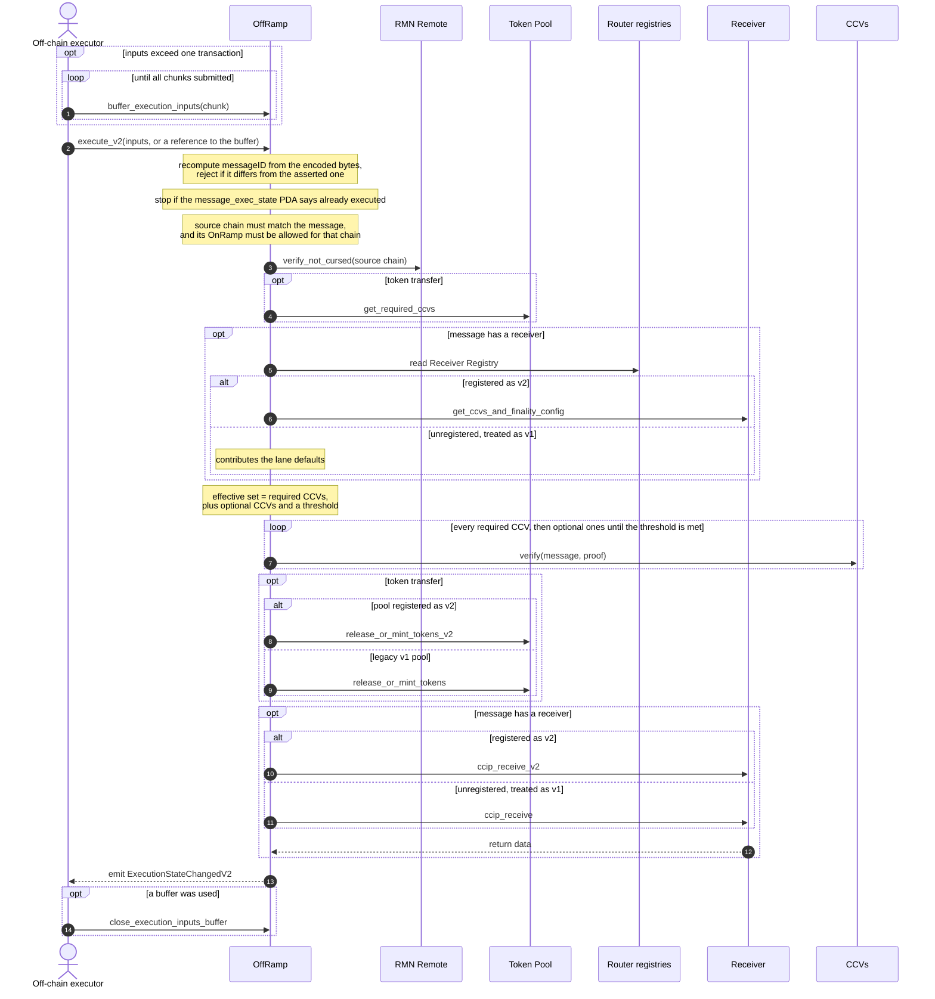

# Solana CCIP v2 Contracts

## Overview

These programs are the Solana implementation of CCIP v2: the on-chain half of both directions — sending a cross-chain message *from* Solana to another chain, and delivering one *to* Solana from another chain. They are an evolution of the audited v1.6 programs, not a rewrite.

One change drives most of the others. In v1.6, security was **infrastructure-defined**: every message on a lane received identical verification, a DON committed a Merkle root, and execution trusted that root. In v2, security is **application-defined**: a message carries the list of Cross-Chain Verifiers (CCVs) that must attest to it, and the destination chain enforces that list on-chain before delivering anything.

Removing the trusted commit step forces the rest of the design:

| v1.6 | v2 |
| --- | --- |
| DON commits a Merkle root; execution trusts it | No commit phase at all; execution itself proves the message was attested |
| Verification bundled into the OffRamp | A standalone Committee Verifier, and an interface any verifier can implement |
| Execution restricted to the DON for a time window | Execution is permissionless from the start |
| The FeeQuoter prices everything | Verifiers, pools and executors price themselves |
| Delivery waits for source finality | Senders may request faster-than-finality delivery |

Two constraints shaped how far this could go.

**Nothing already deployed is forced to change.** Existing v1.6 senders, receivers and token pools keep working untouched, so both protocol versions run side by side. Compatibility is not uniform across integration points, though. Receivers and token pools opt into v2 features through their existing entry points, so upgrading them is genuinely optional. **Senders are the exception**: the v1.6 send methods cannot express v2 features, so reaching v2 means calling new entry points on the same Router. That is why Solana runs **parallel v1.6 and v2 lanes when it is the source**, and why the 1.6 lanes stay alive until senders have migrated.

**Solana's runtime differs from EVM's** in ways that rule out several EVM approaches outright; those differences and what they forced are covered in [Why Solana Shapes the Design](#why-solana-shapes-the-design).

This document explains the design and the reasoning. It deliberately does not restate instruction signatures, account layouts or control flow — those live in the code and the generated IDLs. [Where to Look in the Code](#where-to-look-in-the-code) maps each topic to its source.

### Glossary

- **CCV (Cross-Chain Verifier):** a program that attests a message met some security condition before execution is allowed. The Committee Verifier is the only one implemented here today; CCTP and Lombard verifiers are planned, each shipping inside its token pool program.
- **Committee Verifier:** the default CCV — checks that M-of-N authorized signers signed the message, using secp256k1 ECDSA with Ethereum-compatible address recovery.
- **CCV quorum:** the set of attestations that must be present before a message executes. Assembled from lane, token pool and receiver requirements.
- **Executor:** the program that quotes execution fees and validates, at send time, that a message is one it can service.
- **Lane:** a directional channel between two chains, e.g. Arbitrum → Solana. See [CCIP key concepts](https://docs.chain.link/ccip/concepts/architecture/key-concepts#lane).
- **MessageV1 / MessageID:** the canonical cross-chain encoding, byte-identical across chain families, and its `keccak256` hash. The MessageID is v2's primary identifier, replacing v1.6's `(onramp, destChain, seqNum)` tuple.
- **Receipt:** the Router's record of one component's fee quote — its price plus the destination gas and bytes it is responsible for, stamped with the issuing program. Built by the Router, not returned by the component. Billing data, not verification data.
- **Verifier blob:** an opaque value a CCV returns at send time, emitted in the send event so off-chain verifiers can recognise the messages they must attest to. Distinct from a Receipt.
- **Storage location:** an endpoint a verifier publishes on-chain so off-chain services can fetch its proofs.
- **Faster-Than-Finality (FTF):** delivery before the source chain finalizes, at a finality level the sender requests and every participant must accept.

Everything in this document reflects the programs as they currently exist in this repository. Diagrams show only calls that are in the code.

---

## The Programs and How They Fit Together

CCIP is extensible at five boundaries. They are deliberately independent — each is versioned and provisioned on its own, and nothing requires a party that supplies one to supply another.

| Boundary | Who owns it | Independence |
| --- | --- | --- |
| **Senders** | Users, with a reference implementation | Versioned separately from receivers; reaching v2 means new entry points, hence parallel lanes |
| **Receivers** | Users, with a reference implementation | No parallel lanes — a receiver opts into v2 by registering, or stays v1 indefinitely |
| **Token pools** | Canonical BurnMint / LockRelease, or custom | Opt into v2 per pool, per lane |
| **Verifiers** | CCIP provides the default; anyone may deploy their own | Independent of executors — a party may offer a verifier and no executor, as Circle would for CCTP |
| **Executors** | CCIP provides the default; anyone may deploy their own | Independent of verifiers |

Two Solana-specific notes on how this maps to the EVM contracts. The `ccip-router` program merges the EVM Router and OnRamp into one program, since Solana supports in-place upgrades and needs no proxies — which also keeps CPI depth down. And a single token pool *program* manages many token-specific pools, rather than one contract per token.

| Program | Upgrade strategy | Role in v2 |
| --- | --- | --- |
| **Router & OnRamp** | In place, same Program ID | Hosts both the v1.6 and v2 send flows |
| **FeeQuoter** | In place, same Program ID | Prices; extended with v2 quoting |
| **OffRamp** | **New instance, new Program ID** | v2 execution only; the v1.6 instance stays live |
| **Committee Verifier** | **New program** | Default CCV; takes verification out of the OffRamp |
| **Executor** | **New program** | Quotes execution fees, validates serviceability |
| **RMN Remote** | In place | Curse/uncurse circuit breaker; unchanged |
| **BurnMint / LockRelease pools** | In place | Serve both versions; opt into CCVs, own fees, FTF |
| **CCTP pool** | In place | **Not yet migrated** — v1.6 / CCTP v1 only |
| **Example Sender / Receiver / Receiver V2** | Reference | Integration references |

Why the OffRamp gets a new Program ID while the Router keeps its own: the Router is what users call directly, so its address must stay stable. The OffRamp is never called directly — receivers authenticate it through the Router's allow-list — so a new address per version breaks nothing, and it lets the v1.6 instance keep draining in-flight messages.

---

## Why Solana Shapes the Design

Most of these constraints are unchanged from v1.6, but they explain decisions that would look arbitrary from an EVM perspective.

| Constraint | Consequence |
| --- | --- |
| **A failed CPI cannot be caught** | Interface versions can't be discovered by probing, so they're recorded in **registries** — pools in the Token Admin Registry, receivers in a new Receiver Registry. Unregistered ⇒ treated as v1, which is what makes upgrading optional |
| **No try/catch** | A failure rolls back the whole transaction, so there is no on-chain FAILED state — messages simply stay retryable. The EVM griefing concern, where an executor forces `FAILED` by starving gas, does not apply |
| **Accounts must be declared up front** | Clients cannot know the account list without reading state, hence the iterative [account resolution](#account-resolution) API |
| **1232-byte transactions** | A message plus several CCV proofs may not fit, so execution inputs can be **buffered** across transactions. Lookup tables remain mandatory |
| **CPI depth limit of 4** | v2's extra hops (CCVs, executor) run *parallel* to the existing pool and receiver calls rather than nesting under them, so depth is unaffected |
| **No `view` functions** | Read-only operations are ordinary instructions that clients *simulate* at no on-chain cost. Nothing security-critical depends on them |
| **One message per transaction** | No batched execute, unchanged from v1.6 |

One further consequence is worth naming: the accounts and flags needed to execute on Solana travel inside the message as an opaque **destination blob**. No source-side program parses it — only the Solana OffRamp does — so the Solana account model can evolve without upgrading contracts on remote source chains.

---

## Application-Defined Security: CCVs

Every CCV implements the same small interface: a source-side hook returning its verifier blob, a fee quote, a destination-side `verify`, and account resolution. Because that interface is uniform, neither the Router nor the OffRamp holds verifier-specific logic — **adding a verifier is configuration, not a protocol upgrade**.

Four parties can require a CCV, and a message's effective set is their union:

| Who requires it | Meaning |
| --- | --- |
| **Lane operator** | Mandated CCVs that no sender can opt out of — the lane's security floor |
| **Lane defaults** | Applied when whoever could have chosen didn't. An empty choice means v1.6-equivalent security, never *no* security |
| **Token pool** | A pool can insist on its own verifier for transfers of its token |
| **Receiver** | A v2 receiver declares required CCVs, plus optional ones with a threshold |

At execution these resolve into **required** CCVs, **optional** CCVs and a **threshold**: all required must verify, and enough optional ones to meet the threshold. A lane must always name at least one CCV, so no lane can have zero security.

Two design points follow from this. Defaults are chosen so that anything which does not opt in keeps exactly its v1.6 guarantees — that is what makes the migration safe. And a **pure token transfer** — no receiver callback — never consults a receiver and gets no sender-side defaults, because the only party at risk is the token issuer, who already states their requirements through the pool.

---

## Fees: Every Participant Charges

In v1.6 the FeeQuoter priced everything. In v2 the protocol, every CCV, the executor and the token pool each return a **fee quote** — their price plus the destination gas and bytes they are responsible for. The Router wraps each quote in a **Receipt** stamped with the issuing program, sums them, bills the sender once, and pays each component out. Keeping the Receipt shape on the Router's side means a verifier or pool never has to know about it.

The point is self-service: a token issuer or a third-party verifier sets its own price without anyone changing the protocol. The FeeQuoter still supplies token and gas prices and enforces the lane's gas, size and total-fee limits, but it is no longer the only party quoting.

Two behaviours are not obvious from the outside. The LINK discount is applied to **every** component's fee, not just the protocol's — but *not* to the destination gas cost, which is a pass-through and is added to the executor's receipt afterwards.

The security property that matters: each component's funds accumulate in a vault owned by a PDA of **its own program**, and the protocol's network fee stays with the Router. No component can reach another's balance, and each withdraws independently. Legacy v1 pools are simply not paid, since they predate the interface. The [fee invariants](../contracts/invariants/FEE_INVARIANTS.md) state the accounting requirements precisely.

---

## Faster-Than-Finality

A sender may request delivery before the source chain finalizes. The default is "wait for finality", so anything that does not opt in behaves as it did in v1.6.

FTF is opt-in on both sides and **any participant can refuse it**: a token pool must be a v2 pool to serve it at all and may rate-limit FTF traffic separately; receivers declare the finality they accept alongside their CCVs; the executor and individual CCVs have their own limits.

Note the asymmetry: when Solana is the *source*, the off-chain implementation currently always waits for Solana finality. FTF therefore matters mainly when Solana is the *destination* and the message came from a slower chain. The [finality invariants](../contracts/invariants/FINALITY_INVARIANTS.md) cover the encoding and opt-in rules.

---

## Account Resolution

Because a Solana transaction must declare every account it touches, and a v2 message's account list depends on how many CCVs and pools are involved plus state only the programs can read, clients can no longer hard-code that list.

The Router, OffRamp, CCVs, executor and pools therefore expose an **iterative resolution API**. A client names the instruction it eventually wants to run and calls back repeatedly, accumulating accounts until the program reports no further stage. The client only ever talks to the Router or the OffRamp; those programs call into pools and verifiers as needed.

It takes several rounds because what one round discovers determines what the next must read, and because one transaction can only carry so much. Resolution says nothing about the final instruction's compute budget.

This moves responsibility for a correct account list out of every client and into the programs, so the account model can change without breaking integrations. **Resolution is not security-critical**: its output only *constructs* a transaction, and the real instructions re-validate every account they are handed.

---

## What Each Program Is Responsible For

Only what changed from v1.6 or is otherwise non-obvious. Everything else is in the code.

### Router & OnRamp

Upgraded in place, so existing integrations are untouched. It hosts **both** send flows, chosen per lane, which is what produces the parallel source-side lanes described above.

Its substantive v2 job is CCV integration at the source: resolve the effective verifier list, collect a fee receipt and verifier blob from each, and emit them so off-chain verifiers can find their work. It also hosts both registries — the Token Admin Registry, now carrying each pool's interface version, and the new Receiver Registry.

### FeeQuoter

Still the source of token and gas prices, and still the owner of the LINK discount, but no longer the only component that quotes and no longer the place ExtraArgs are parsed — that moved to the Router.

One thing to know: **v2 lanes reuse v1.6 gas prices.** The v2 config reserves a price field, but the quoter reads the live price from v1.6 state, which the v1.6 OffRamp keeps updated. A dedicated v2 price updater is future work.

### Committee Verifier

The default CCV, and new in v2 — in v1.6 this signature check lived inside the OffRamp's commit flow. Separating it lets the verifier be upgraded independently, keeps the OffRamp smaller, and gives the protocol one interface shared with *every* verifier rather than a privileged built-in.

It holds a signer set and threshold per source chain and verifies secp256k1 ECDSA signatures with Ethereum address recovery — the same scheme as the EVM Committee Verifier, so one set of committee keys serves every chain family. Two properties matter for security:

- The signed hash binds a **version tag** to the MessageID, so signatures cannot be replayed across verifier upgrades. Because the MessageID is the hash of the canonical encoding, attesting to it secures the entire message.
- Signatures must arrive in **strictly ascending signer order**, which makes double-counting a signer impossible and lets verification stop as soon as the threshold is met.

### Executor

Execution is permissionless and this program does not gate it. What it provides is the on-chain footprint that makes third-party execution practical: it quotes the execution fee at send time so the cost is collected up front and can be paid to whoever executes, and it **validates serviceability at send time** — which verifiers it can work with, which finality it accepts, how many CCVs a message may carry. A message it could never execute is rejected while sending rather than becoming stuck later.

A sender may opt out of automated execution with a sentinel executor value; the fee is then zero and delivery is left to whoever wants it.

### OffRamp

A new program instance, following the same pattern as v1.6 inter-version upgrades. The v1.6 OffRamp is never shut down — it still serves messages sent before a lane was upgraded, and lanes still on 1.6. This is where v2 diverges most:

- **No commit phase.** No OCR3 report, no Merkle root, no commit instruction.
- **Verification happens during execution.** Before touching a pool or receiver, the OffRamp checks on-chain that the message's required CCVs have attested. In v1.6 the only execute-time check was that a committed root was correct.
- **Anyone can execute.** No privileged window.
- **No ordering.** Messages execute out of order with no nonce or sequence number; replay protection comes from a per-message execution-state account keyed by MessageID.
- **Inputs can be buffered** across transactions when proofs don't fit in one.

### Token Pools

BurnMint and LockRelease serve both protocol versions from one program. **No migration is required** — a pool that never declares v2 support behaves exactly as in v1.6, on either kind of lane. The CCTP pool has not been migrated yet.

Declaring v2 opts a pool into requiring its own CCVs, charging its own fee, and serving FTF traffic with separate rate limits. Together these make token onboarding self-serve: the issuer expresses their own risk appetite without a protocol change, which is a natural boundary since holders of a token already trust its issuer.

v2 also fixes **one token transfer per message**, closing the class of attacks where one token in a multi-token transfer interferes with another.

### Receivers

Upgrading is **optional**. A receiver only changes if it wants v2 features — declaring CCVs, or accepting FTF — in which case it implements the v2 interface and registers. Unregistered receivers are treated as v1, keep safe defaults, and work indefinitely.

A registered v2 receiver is called through a distinct entry point and is additionally queried during CCV resolution for its requirements and accepted finality.

### RMN Remote

Unchanged in v2. It is the circuit breaker: cursing a subject — a source chain, a lane, or everything — makes the Router's and OffRamp's checks revert, halting sends and executions on the affected lane. It does **not** bless Merkle roots; that was a v1.6 intent never used, and v2 has no roots to bless.

---

## Message Flows

The Router is the only program users call directly; the OffRamp is the only one that drives execution. Everything else is reached over CPI. Token pools, CCVs and RMN Remote are each called from *both* sides, using a different part of their interface in each direction — which is why they are single programs rather than per-direction pairs.

### Sending a Message

Two orderings in the diagram below are deliberate and not what you might guess. The **token transfer happens before fees are collected**, because the pool is the source of both its own fee receipt and its required CCVs. And the **effective CCV list must be complete before any verifier is charged**, since that list is precisely what determines who to charge.

`get_fee_v2` runs this same pipeline without the transfer or the settlement, so a quote always matches what is actually billed.

### Executing a Message

The CCV quorum check is the substance of v2: with no commit step, **execution itself is what proves the message was attested**. Any failure aborts the transaction, leaving the message untouched and retryable.

Note also that the MessageID is recomputed from the encoded bytes and checked against the one the executor asserted. The asserted value is needed only to derive the execution-state account before the message can be read, so a wrong assertion can fail the transaction but can never redirect it.

---

## Migrating from v1.6

CCIP 1.6 has run on Solana for over a year. The migration is designed so both versions coexist and nothing is forced to change on a deadline.

| | Approach |
| --- | --- |
| New deployments | OffRamp, Committee Verifier, Executor |
| Upgraded in place | Router & OnRamp, FeeQuoter, RMN Remote, all token pools |
| Solana as source | **Parallel lanes** — both send paths live for the same destination |
| Solana as destination | **No parallel lanes** — a lane is either 1.6 or 2.0 and uses the matching OffRamp |
| Off-chain | Net-new deployment; DONs keep serving 1.6, new verifiers and executors serve 2.0 |

**Senders are where Solana diverges from EVM.** Both send paths stay available after a lane goes v2, so senders migrate on their own schedule; an end-of-life date is published for upgraded lanes. Customers with custom sender *programs* must upgrade them before 1.6 lanes are decommissioned — analysis suggests very few exist.

**Manual execution moves with the OffRamp**, so tooling that performed manual executions on 1.6 must target the new address for upgraded lanes, where execution is now permissionless.

**Receivers and token pools need no changes** unless they want v2 features.

**State is preserved** for in-place upgrades: most 1.6 accounts are reused, with v2-specific ones added where needed. Where a schema change is unavoidable — the Token Admin Registry is the main case — migration is lazy and both layouts are supported concurrently.

---

## Where to Look in the Code

| Topic | Location |
| --- | --- |
| Instruction surface of any program | `contracts/programs/<program>/src/lib.rs` |
| Send and fee logic | `contracts/programs/ccip-router/src/instructions/{ccip_send,get_fee}/` |
| Execution and CCV quorum | `contracts/programs/ccip-offramp/src/instructions/execute/` |
| CCV requirement resolution, shared by execution and its view instruction | `contracts/programs/ccip-offramp/src/instructions/ccv_resolution.rs` |
| Signature verification | `contracts/programs/committee-verifier/src/instructions/verify/` |
| Canonical message encoding, ExtraArgs, finality | `contracts/programs/ccip-common/src/{messages.rs,extra_args.rs}` |
| CCV and pool CPI helpers | `contracts/programs/ccip-common/src/{ccvs.rs,v2.rs}` |
| Account resolution protocol types | `contracts/programs/ccip-common/src/resolution.rs` |
| PDA seeds | `contracts/programs/ccip-common/src/seed.rs` |
| Pool interface discriminators | `contracts/programs/base-token-pool/src/constants.rs` |
| Protocol invariants | `contracts/invariants/` |
| Generated bindings | `contracts/gobindings/` |

**Invariants are the best entry point for reviewers.** CCIP v2 defines a numbered set of chain-agnostic invariants that must hold in every implementation; they capture and justify several subtle decisions and should be treated as ground truth. The base set lives in [chainlink-ccip](https://github.com/smartcontractkit/chainlink-ccip/tree/main/chains/evm/contracts/invariants/), and the Solana-specific deviations and additions are in [`contracts/invariants/`](../contracts/invariants/README.md), split by topic.

For CCIP as a product rather than this implementation, see the [public documentation](https://docs.chain.link/ccip).
