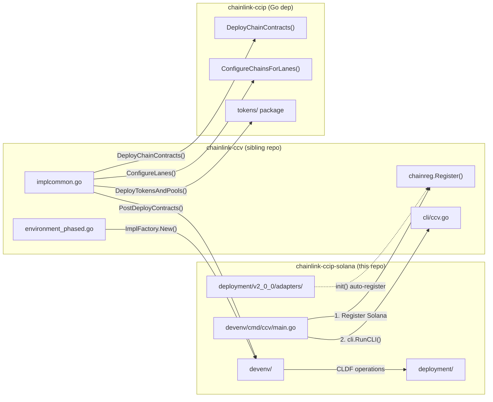
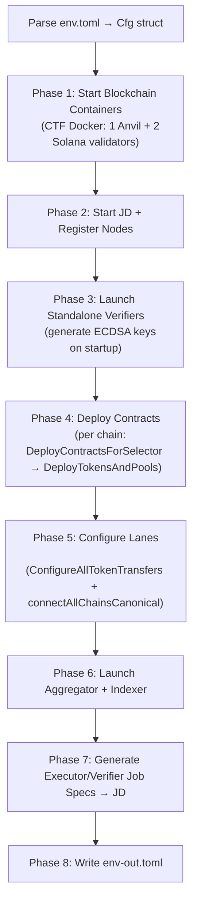
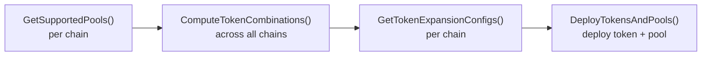
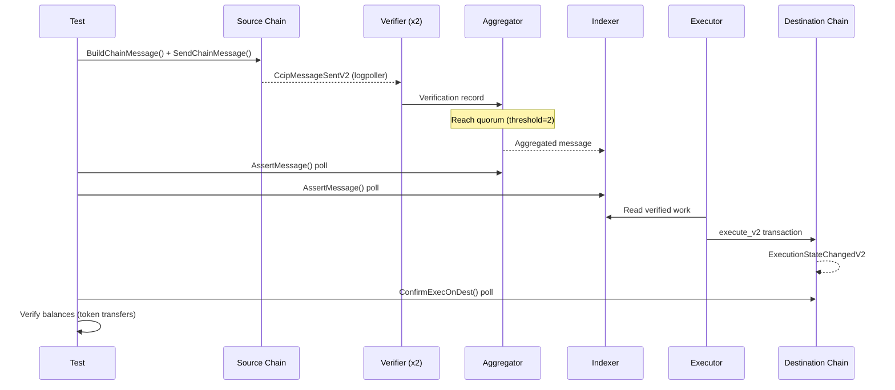

# Devenv E2E Architecture

This guide explains the Solana CCIP devenv flow from chain setup to message execution.
See the [devenv operations guide](../../devenv/README.md) for operations.

## Table of Contents

- [Repos Involved](#repos-involved)
- [Environment Bootstrap](#environment-bootstrap-make-start-devenv)
  - [Build Prerequisites](#1-build-prerequisites)
  - [CLI Entry Point](#2-cli-entry-point)
  - [Phased Startup](#3-phased-startup-ccv-up)
  - [Contract Deployment (Solana)](#phase-4-contract-deployment)
  - [Token Deployment](#token-deployment)
  - [Lane Configuration](#phase-5-lane-configuration)
  - [Services Launch](#phase-6-services-launch)
- [E2E Test Execution](#e2e-test-execution)
  - [Test Setup](#1-test-setup)
  - [Message Lifecycle](#2-message-lifecycle)
  - [Solana-Specific Messaging](#3-solana-specific-messaging)
  - [Token Transfers](#4-token-transfers-in-tests)
- [Key Files Reference](#key-files-reference)

---

## Repos Involved

Three repositories participate in the devenv:

| Repo                      | Role                                                                                                           | Location                         |
| ------------------------- | -------------------------------------------------------------------------------------------------------------- | -------------------------------- |
| **chainlink-ccip-solana** | Solana chain impl, contract bindings, deployment ops, devenv CLI entry point                                   | this repo                        |
| **chainlink-ccv**         | CCV framework — devenv runtime, chain registry, test interfaces, aggregator/indexer/verifier/executor services | `../chainlink-ccv` (sibling dir) |
| **chainlink-ccip**        | EVM chain impl, shared deployment changesets, lane configuration                                               | Go module dependency             |



### Key Packages (this repo)

| Package                         | Purpose                                                                                                                                                |
| ------------------------------- | ------------------------------------------------------------------------------------------------------------------------------------------------------ |
| `devenv/`                       | Solana chain impl (`Chain` struct), `ImplFactory`, tokens, messaging, deployment, signer pool                                                          |
| `devenv/ccvregistry/`           | CLDF provider factory, chain config loader, verifier modifier                                                                                          |
| `devenv/cmd/ccv/`               | CLI entry point that registers Solana with `chainreg` and runs `cli.RunCLI()`                                                                          |
| `deployment/v2_0_0/operations/` | Per-contract CLDF operations (router, offramp, feequoter, etc.)                                                                                        |
| `deployment/v2_0_0/sequences/`  | Orchestration sequences (deploy chain, configure lanes, tokens)                                                                                        |
| `deployment/v2_0_0/adapters/`   | CCV adapter registrations (init() auto-registers): committee verifier, executor config, aggregator config, indexer config, fees, curse, token verifier |

---

## Environment Bootstrap (`make start-devenv`)

### 1. Build Prerequisites

```
make start-devenv
  ├── ensure-contract-deploy-dir    # Verify contracts/target/deploy/*.so exist
  ├── build-ccv-images              # cd ../chainlink-ccv/build/devenv && just build-docker
  ├── build-solana-verifier-image   # docker build cmd/committeeverifier/Dockerfile → solana-verifier:latest
  └── build-solana-executor-image   # docker build cmd/executor/Dockerfile → solana-executor:latest
```

Programs must be built first with `make docker-build-contracts` (one-time after clone or Rust changes).

### 2. CLI Entry Point

`devenv/cmd/ccv/main.go` does two things in `init()`:

1. **Registers Solana with the CCV chain registry:**
   ```go
   chainreg.Register(chainsel.FamilySolana, chainreg.Registration{
       ImplFactory:       soldevenv.NewImplFactory(),       // creates Chain instances
       CLDFProvider:      ccvregistry.SolanaCLDFProviderFactory, // CLDF chain provider
       ChainConfigLoader: ccvregistry.SolanaChainConfigLoader,   // builds chain config maps
       VerifierModifier:  ccvregistry.SolanaVerifierModifier,    // customizes verifier container
       ExecutorModifier:  soldevenv.SolanaExecutorModifier,      // prefixes "solana-"
   })
   ```

2. **Side-effect imports** `_ deployment/v2_0_0/adapters` which triggers adapter `init()` registrations (committee verifier, executor config, aggregator config, indexer config, fee aggregator, fees, curse, token verifier, and deploy chain contracts adapters).

Then `main()` calls `cli.RunCLI()` (CCV cobra CLI), which runs `go run devenv/cmd/ccv/main.go up devenv/env.toml`.

### 3. Phased Startup (`ccv up`)

The `up` command calls `NewPhasedEnvironment()` in CCV's `environment_phased.go`, which orchestrates:



#### env.toml Configuration

`devenv/env.toml` defines the environment topology:
- **3 blockchains**: 1 Anvil (EVM, chain ID 1337) + 2 Solana validators (chain IDs `222...` and `333...`)
- **4 verifiers**: 2 EVM (read EVM source) + 2 Solana (read Solana sources)
- **2 executors**: 1 EVM (Solana→EVM) + 1 Solana (EVM→Solana, S2S)
- **1 aggregator** with Postgres + Redis
- **1 indexer** subscribing to the aggregator
- **1 committee** (`default`) covering all 3 chains, threshold=2

Solana program addresses are specified per chain in `[blockchains.solana_programs]` — these are canonical addresses from `Anchor.toml`.

#### Phase 1: Blockchain Containers

CTF (Chainlink Testing Framework) spins up Docker containers:
- **Solana**: Local validators with programs pre-loaded via `--upgradeable-program` flags. No BPF deploy or keypair management needed.
- **EVM**: Anvil with 1-second block time.

#### Phase 3: Verifier Launch

Verifiers start early because they generate ECDSA signing keys on startup. The framework queries their `/info` endpoint to discover signer addresses, which are needed for contract deployment (CommitteeVerifier signer config).

### Phase 4: Contract Deployment

The CCV framework iterates each chain and calls `DeployContractsForSelector()` (in CCV's `implcommon.go`):

```
DeployContractsForSelector(ctx, env, impl, selector, topology)
  ├── impl.PreDeployContractsForSelector()    → Solana: registers address refs for the preloaded programs
  ├── ccipChangesets.DeployChainContracts()   → CCV changeset: runs the core init sequence (table below)
  └── impl.PostDeployContractsForSelector()   → Solana: initializes the message receiver
```

The CCV **`DeployChainContracts()`** changeset (`deployment/v2_0_0/sequences/deploy_chain_contracts.go`) runs these CLDF operations in sequence:

| #   | Operation                                 | Key Parameters                                                                                                                 |
| --- | ----------------------------------------- | ------------------------------------------------------------------------------------------------------------------------------ |
| 1   | `fqops.Initialize`                        | maxFeeJuelsPerMsg, router, offramp, LINK=WSOL                                                                                  |
| 2   | `fqops.AddPriceUpdater`                   | offramp as price updater                                                                                                       |
| 3   | `rmnremoteops.Initialize`                 | RMNRemote program ID                                                                                                           |
| 4   | `routerops.Initialize`                    | fee quoter, RMN, LINK=WSOL                                                                                                     |
| 5   | `executorops.Initialize`                  | maxCcvsPerMsg=10 (from `GetDeployChainContractsCfg`), feeAggregator=deployer, finality blockDepth=1, ccvAllowlistEnabled=false |
| 6   | `offrampops.Initialize`                   | fee quoter, offramp, router, RMN                                                                                               |
| 7   | `offrampops.InitializeConfig`             | enableExecutionAfter=0                                                                                                         |
| 8   | Extend OffRamp LUT                        | 16+ PDAs (offramp, fee quoter, router, RMN, token pools, CV)                                                                   |
| 9   | Create CcipSend LUT                       | 12 PDAs for `ccip_send_v2` transactions; `routerops.UpdateReferenceAddresses` for the resolver to return it                        |
| 10  | `cvops.Initialize`                        | CommitteeVerifier program ID                                                                                                   |
| 11  | `cvops.SetFeeAggregator`                  | Fee aggregator address from topology                                                                                           |
| 12  | `cvops.SetStorageLocations`               | Postgres URL for aggregator DB                                                                                                 |
| 13  | Per source chain: `cvops.SetChainConfig`  | remoteChainSelector, routerSigner PDA (CCVSignerPDA), feeUSDCents=0, gasForVerification=500k, payloadSizeBytes=390             |
| 14  | Per source chain: `cvops.SetSignerConfig` | threshold, ECDSA signer addresses from verifier /info                                                                          |
| 15  | Extend OffRamp LUT per-lane               | AllowedOfframpPDA + CVRemoteChainConfigPDA per source                                                                          |

After all operations, deployed contract addresses are registered in the CLDF datastore (Router, OnRamp, OffRamp, FeeQuoter, CommitteeVerifier, Executor (as `ExecutorProxy` — the proxy abstraction leaks from EVM), RMNRemote (registered under both 1.6.0 and 2.0.0 versions), CcipSendLookupTable, token pool programs (BurnMint/LockRelease with `PoolProgramQualifier`), and CommitteeVerifier signer addresses (persisted so they survive restarts)).

Then **`PostDeployContractsForSelector()`** (`devenv/deployment.go`) runs the Solana-specific post-deploy step: `testreceiverops.Initialize`, which initializes the message receiver (`test_ccip_receiver`) used by the arbitrary-messaging e2e cases (creates its `counter` + `external_execution_config` PDAs and records the router it trusts).

The `GetDeployChainContractsCfg()` method provides the executor deployment parameters (version, maxCCVsPerMsg, qualifier, dynamic config) used by both `PostDeployContractsForSelector` and the CCV framework's `DeployChainContracts` changeset.

> **Note**: WSOL is used as a LINK token stand-in. A real LINK SPL token is not yet deployed in devenv.

> **Note**: On execution, the OffRamp CPIs into the message receiver's `ccip_receive` (v1 interface) for arbitrary messages; pure token transfers skip the receiver call. A successful execution sets the message state to `Success`.

### Token Deployment

After core contracts, `DeployTokensAndPools()` (CCV `implcommon.go`) handles tokens:



#### How tokens are determined

1. **Each chain declares its pool capabilities** via `GetSupportedPools()`:
   - **Solana** (`devenv/tokens.go`): BurnMint 1.6.1, LockRelease 1.6.1, BurnMint 2.0.0, LockRelease 2.0.0
   - **EVM**: BurnMint 1.6.1/2.0.0, LockRelease 1.6.1/2.0.0

2. **`ComputeTokenCombinations()`** (CCV `common/common.go`) creates valid cross-chain pool pairings from per-chain capabilities. Each combination produces a "TEST" token with a qualifier encoding the pool types, e.g.:
   - `"TEST (BurnMintTokenPool 1.6.1 [], BurnMintTokenPool 1.6.1 [])::BurnMintTokenPool 1.6.1 []"`
   - `"TEST (BurnMintTokenPool 2.0.0 [default], LockReleaseTokenPool 1.6.1 [])::LockReleaseTokenPool 1.6.1 []"`

3. **`GetTokenExpansionConfigs()`** (`devenv/tokens.go`) builds one config per unique pool type:
   - Token type: SPL (standard Solana token)
   - Decimals: 6
   - Pre-mint: 1,000 tokens
   - External admin + CCIP admin + Senders: deployer key
   - Only pools supported by this chain are deployed
   - `SkipOwnershipTransfer`: true (pending MCMS/timelock support)

4. **`PostTokenDeploy()`** — no-op for Solana (EVM uses it for additional setup).

> **Note**: Token pool program entries (BurnMint and LockRelease) are registered in the CLDF datastore during `PostDeployContractsForSelector()` using the `PoolProgramQualifier` so downstream sequences like `DeployTokenPoolForToken` can look them up.

#### Token transfer configuration

After all tokens are deployed across all chains:

1. **`ConfigureAllTokenTransfers()`** (CCV `implcommon.go`) iterates each chain and calls `GetTokenTransferConfigs()`.

2. **`GetTokenTransferConfigs()`** (`devenv/tokens.go`) builds `TokenTransferConfig` entries:
   - Filters applicable combinations via `devenvcommon.FilterTokenCombinations()` using the topology and datastore
   - For each combo, checks which remote selectors have the remote pool deployed
   - Maps local pool → remote pool refs via CLDF datastore
   - Merges configs with the same pool key (adds remote chains to existing entries)

### Phase 5: Lane Configuration

After tokens, `connectAllChainsCanonical()` configures cross-chain lanes:

For each pair of chains:
- **Source side**: Add destination chain config to FeeQuoter and Router, setup Executor
- **Destination side**: Register OffRamp on Router, add source chain config to OffRamp

This uses the `ConfigureChainsForLanesFromTopology` changeset from `chainlink-ccip`.

Each chain provides its lane profile via `GetChainLaneProfile()`, which specifies:
- `BaseExecutionGasCost`: 150,000
- `TokenReceiverAllowed`: true
- `FeeQuoterDestChainConfig`: USDPerUnitGas = 1e6
- `ExecutorDestChainConfig`: Enabled = true
- Default inbound/outbound CCVs: CommitteeVerifier with "default" qualifier
- `GasForVerification`: 500,000

After lane connection, `PostConnect()` is called per chain (currently a no-op, placeholder for custom executor support).

### Phase 6: Services Launch

1. **Aggregator** — Docker container with Postgres + Redis. HMAC credentials generated for verifier/executor/indexer clients. Committee config generated from on-chain state via changesets.

2. **Indexer** — Docker container subscribing to aggregator. Stores aggregated messages in its own Postgres.

3. **Executors** — Job specs generated from topology + on-chain state, proposed to JD. The Solana executor binary (`cmd/executor/main.go`) uses CCV bootstrap pattern with Solana-specific accessors (`pkg/accessors`).

4. **Verifiers** — Job specs generated and proposed to JD. Each verifier reads from its configured source chains.

### Phase 8: Output

`env-out.toml` is written at the repo root with:
- All deployed contract addresses per chain
- Committee configurations (signers, thresholds)
- Token pool addresses
- Service endpoints (aggregator, indexer)
- Verifier bootstrap keys
- Executor configurations

---

## E2E Test Execution

Tests live in `devenv/tests/smoke/` (functional smoke) and `devenv/tests/load/` (sustained RPS load) and expect the devenv to already be running.

When the tests run against a deployed environment, set `TARGET_EVM_SELECTOR` if the manifest has more than one EVM chain. The run fails when several EVM chains exist and the variable is not set.
Set `USE_TEST_ROUTER=true` when the 2.0 lane is on the EVM TestRouter, not on the production Router. EVM-source sends and the token allowance then use the TestRouter.

### 1. Test Setup

Both test files (`evm2solana_test.go`, `solana2evm_test.go`) follow a similar setup pattern:

```go
// 1. Register Solana chain family (EVM auto-registered via evm_factory.go init())
chainreg.Register(chainsel.FamilySolana, chainreg.Registration{
    ImplFactory:  soldevenv.NewImplFactory(),
    CLDFProvider: ccvregistry.SolanaCLDFProviderFactory,
})

// 2. Load the output config written by `make start-devenv`
in, _ := ccv.LoadOutput[ccv.Cfg]("../../env-out.toml")

// 3. Create the CCV library — builds CLDF chain providers for all chains
lib, _ := ccv.NewLibFromCCVEnv(logger, "../../env-out.toml")

// 4. Build chain impls — calls ImplFactory.New() for each chain
chains, _ := lib.ChainsMap(ctx)  // map[chainSelector]CCIP17

// 5. Get aggregator + indexer clients
aggregatorClient, _ := in.NewAggregatorClientForCommittee(logger, "default")
indexerClient, _ := indexerclient.NewIndexerClient(in.IndexerEndpoints[0], httpClient)
indexerMonitor, _ := ccv.NewIndexerMonitor(logger, indexerClient)

// 6. Create test context (wraps aggregator + indexer for assertions)
testCtx := e2ehelpers.NewTestingContext(t, ctx, nil, aggregatorClient, indexerMonitor)
```

> **Note**: The Solana↔Solana test uses a different chain creation pattern: it generates fresh random keypairs, funds them via `testutils.FundAccounts()`, and calls `soldevenv.New()` directly instead of going through `lib.ChainsMap()`. This provides test isolation — devenv services use the validator's default deployer key while tests get their own keypairs.

The `ImplFactory.New()` method (in `devenv/impl.go`) creates a `Chain` struct from the CLDF environment:
- Gets the Solana chain from `env.BlockChains.SolanaChains()`
- Extracts the deployer key
- Returns a `Chain` implementing `CCIP17`, `CCIP17Configuration`, `ChainAsSource`, `ChainAsDestination`, `MessageV3Destination`, and `TokenConfigProvider`

The `ImplFactory` also provides:
- `DefaultSignerKey(keys)` → returns the ECDSA address from bootstrap keys
- `DefaultFeeAggregator(env, selector)` → returns the deployer key's public key
- `SupportsFunding()` → returns `true`
- `NewEmpty()` → creates a `Chain` with no RPC state (used by CCV framework for `FundAddresses` calls)

### 2. Message Lifecycle



#### Sending (Test → Source Chain)

1. **`BuildChainMessage()`** — Creates message with receiver address, optional token amounts, extra args, and arbitrary data.
2. **`SendChainMessage(ctx, destSelector, message, sendOption)`** — Submits transaction to source chain. Accepts `SolanaSendOptions` for signer override.
3. Returns `MessageSentEvent` containing `MessageID` (used for tracking) + tx signature.

#### Verification (Off-Chain)

4. Verifier logpoller detects `CcipMessageSentV2` event on source chain.
5. Verifier creates a verification record and sends it to the aggregator.
6. Aggregator accumulates results and reaches quorum (threshold=2 in devenv).
7. Aggregated message is ingested by the indexer.

#### Test Assertion

8. **`testCtx.AssertMessage(messageID, opts)`** — Polls both aggregator and indexer:
   - Waits for `AggregatedResult` with CCV data
   - Confirms indexed verification exists
   - Configurable timeout (default 3 minutes) and tick interval

#### Execution (Off-Chain)

9. Executor reads verified work from indexer.
10. Submits `execute_v2` transaction to destination chain's offramp.
11. OffRamp emits `ExecutionStateChangedV2` event.

#### Test Confirmation

12. **`chain.ConfirmExecOnDest(ctx, sourceSelector, key, timeout)`** — Polls offramp logpoller for terminal execution state. The `key` is a `MessageEventKey` containing `MessageID` and/or `SeqNum`.
13. Verifies `ExecutionStateSuccess`.
14. For token transfers: verifies sender balance decreased and receiver balance increased.

### 3. Solana-Specific Messaging

When Solana is the **source chain**, `devenv/messaging.go` handles:

**`BuildChainMessage()`**:
- Creates `Svm2AnyMessage` struct
- Generates random 8-byte nonce (ensures unique `MessageID` per build)
- Converts `TokenAmount` to `SvmTokenAmount` format
- Uses `FeeToken = PublicKey{}` (native SOL)

**`SendMessage()`** (backward compat wrapper):
- Delegates to `BuildChainMessage()` + `SendChainMessage()`, serializing extra args via `SerializeMessageV3ExtraArgs()`.

**`SendChainMessage()`**:
1. Resolves signer key (deployer or override from `SolanaSendOptions.Signer`)
2. Looks up Router, CommitteeVerifier, and Executor program IDs from CLDF datastore
3. Builds V3 extra args with CCV + executor (receipts are produced on-chain by the router calling each CCV's `get_fee`, not client-side mocks)
4. Builds executor args (`SvmExecutorArgs.BorshEncode`) with `SvmDestBlob`
5. Resolves `ccip_send_v2` accounts via `ccip.ResolveCcipSendV2Accounts` (mock inputs: `DestBlob` only)
6. Fetches the address lookup tables resolution returned (the router's onramp LUT, plus the token pool's for transfers)
7. Sends via `SendAndConfirmWithLookupTables`
8. Extracts `CcipMessageSentV2` CPI event from transaction logs
9. Decodes message via `protocol.DecodeMessage`
10. Returns `MessageSentEvent` + tx signature

**`BuildV3ExtraArgs()`**:
- Builds V3 extra args by calling the destination chain's `GetExecutorArgs()`, `GetTokenArgs()`, and `GetTokenReceiver()`, then serializing via `SerializeMessageV3ExtraArgs()` (currently a no-op placeholder — Solana V3 gobindings not yet available).

**`GetExpectedNextSequenceNumber()`**:
- Reads the `DestChain` state PDA from the router to return `sequenceNumber + 1`.

When Solana is the **destination chain**, `devenv/chain.go` handles:

**`ConfirmSendOnSource()`**: Polls router logpoller for `CcipMessageSentV2` events matching the `MessageID` or `SeqNum`. Decodes message via `protocol.DecodeMessage` to extract sequence number and receipt issuers.

**`ConfirmExecOnDest()`**: Polls offramp logpoller for `ExecutionStateChangedV2` events, matches by MessageID or SeqNum, waits for terminal state (Success or Failure).

**`GetTokenBalance()`**: Derives the Associated Token Account (ATA) for owner + mint, fetches SPL balance via RPC. Returns 0 if the ATA doesn't exist yet.

**`GetEOAReceiverAddress()`**: Deprecated. Returns the v2 example receiver program as a fallback, because Solana has no EOA concept and callers such as the ccv load gun resolve the receiver for every destination. Use `AddressResolver.GetContractReceiver` instead; pass `LegacyReceiverQualifier` to select the v1 receiver.

**`NativeBalance()`**: Returns SOL balance in lamports for a given address.

**`TransferNative()`**: Moves SOL between accounts. The `from` address must be the deployer key or a key in the signer pool.

**`FundAddresses()`**: Sends whole-SOL `nativeAmount` values to multiple addresses, converts to lamports internally, and batches up to 20 transfers per transaction. Filters out invalid addresses (wrong-length, off-curve PDAs). Supports both CCV framework callers (via `bc` blockchain input) and internal callers (via struct state).

**`InitSignerPool()`**: Generates `n` random keypairs and funds each with 1 SOL from the deployer. The `SignerPool` provides lock-free round-robin access via `NextUser()` for concurrent transaction signing (max 20 keys).

**`Close()`**: Shuts down shared logpoller services. Idempotent; subsequent calls are no-ops.

Logpollers are lazily initialized on first use (`initPollers()`) and shared across all `ConfirmSendOnSource`/`ConfirmExecOnDest` calls.

### 4. Token Transfers in Tests

Token transfer tests (`TokenTransfer/BurnMint`, `TokenTransfer/LockRelease`) exercise the full flow with balance verification:

1. **Look up token addresses** from CLDF datastore using pool-type qualifiers
2. **Pre-fund LockRelease pools** with 100 tokens via `ProvideLockReleaseLiquidity()`
3. **Snapshot balances** before transfer (sender on source, receiver on destination)
4. **Send 1 token** (10^18 EVM wei → 10^6 Solana base units, conversion factor 10^12)
5. **Wait for aggregation + execution**
6. **Verify balances**: sender decreased by transfer amount, receiver increased by converted amount

Token qualifiers in the datastore encode the pool types:
```
Solana BurnMint:      "TEST (BurnMintTokenPool 1.6.1 [], BurnMintTokenPool 1.6.1 [])::BurnMintTokenPool 1.6.1 []"
Solana LockRelease:   "TEST (BurnMintTokenPool 2.0.0 [default], LockReleaseTokenPool 1.6.1 [])::LockReleaseTokenPool 1.6.1 []"
EVM (for LR combo):   "TEST (BurnMintTokenPool 2.0.0 [default], LockReleaseTokenPool 1.6.1 [])::BurnMintTokenPool 2.0.0 [default]"
```

#### Qualifier anatomy

Each qualifier is built by `poolInstanceQualifier` in CCV:

```go
func poolInstanceQualifier(poolDesc, counterpartPoolDesc string) string {
    return fmt.Sprintf("%s::%s", poolPairQualifier(poolDesc, counterpartPoolDesc), poolDesc)
}
```

Taking `"TEST (BurnMintTokenPool 2.0.0 [default], LockReleaseTokenPool 1.6.1 [])::LockReleaseTokenPool 1.6.1 []"` as an example:

| Part                                                                 | Meaning                                                                                                                                                                                                  |
| -------------------------------------------------------------------- | -------------------------------------------------------------------------------------------------------------------------------------------------------------------------------------------------------- |
| `TEST`                                                               | Synthetic test token deployed by the devenv (not a real USDC/LINK/etc.)                                                                                                                                  |
| `(BurnMintTokenPool 2.0.0 [default], LockReleaseTokenPool 1.6.1 [])` | **Pair key** — the two chain-pool descriptions sorted alphabetically, uniquely identifying which cross-chain token combo this is                                                                         |
| `BurnMintTokenPool 2.0.0`                                            | Pool type + version on one side of the lane (EVM in this case)                                                                                                                                           |
| `[default]`                                                          | CCV qualifier — `[default]` means this pool version requires the default committee verifier (v2.0.0+ pools). An empty `[]` means no CCV qualifier needed (v1.6.1 pools don't use the committee verifier) |
| `LockReleaseTokenPool 1.6.1 []`                                      | Pool type + version on the other side (Solana), with empty CCV qualifier                                                                                                                                 |
| `::`                                                                 | Separator — everything after identifies which specific instance on **this** chain                                                                                                                        |
| `LockReleaseTokenPool 1.6.1 []`                                      | **Local pool** for this chain (Solana's pool). The test lookup uses this to find which token address was deployed for Solana                                                                             |

**Why both occurrences are required:**

- **Inside `( , )`** — the **pair key**: a canonical, sorted identifier for the cross-chain token combination. It must include both pool descriptions so the datastore can uniquely identify which token was deployed for the pairing EVM-BurnMint-2.0.0 ↔ Solana-LockRelease-1.6.1. Without it, the qualifier would collide with a hypothetical BurnMint↔BurnMint combo that also has `BurnMintTokenPool 2.0.0 [default]` in it.
- **After `::`** — the **local instance**: which specific pool on this chain the datastore entry belongs to. This is what differs between the two chains for the same combo.

The pair inside `( , )` is always sorted alphabetically (see `poolPairQualifier` in CCV), so both chains produce the same pair string. The `::localPool` suffix is what differs between chains — on EVM that suffix would be `BurnMintTokenPool 2.0.0 [default]`, on Solana it's `LockReleaseTokenPool 1.6.1 []`.

> **Note**: V2 token pool test cases (BurnMint 2.0.0/2.0.0 and LockRelease 2.0.0/2.0.0 combinations) are defined but commented out, pending offramp v2 CPI branching and router v2 onramp support.

---

## Key Files Reference

### devenv/ (this repo)

| File                              | Purpose                                                                                                                                                                  |
| --------------------------------- | ------------------------------------------------------------------------------------------------------------------------------------------------------------------------ |
| `signer_pool.go`                  | `SignerPool` — pre-generated keypairs with lock-free round-robin for concurrent signing                                                                                  |
| `cmd/ccv/main.go`                 | CLI entry point; registers Solana with `chainreg`, calls `cli.RunCLI()`                                                                                                  |
| `chain.go`                        | `Chain` struct implementing CCIP17 + CCIP17Configuration (send, confirm, balance, funding, logpollers, signer pool)                                                      |
| `deployment.go`                   | `PostDeployContractsForSelector()`, `GetDeployChainContractsCfg()`, `GetChainLaneProfile()`, `PostConnect()` — all Solana contract initialization and lane configuration |
| `messaging.go`                    | `BuildChainMessage()`, `SendChainMessage()`, `SendMessage()`, `BuildV3ExtraArgs()`, `GetExpectedNextSequenceNumber()`                                                    |
| `tokens.go`                       | `GetSupportedPools()`, `GetTokenExpansionConfigs()`, `GetTokenTransferConfigs()`                                                                                         |
| `impl.go`                         | `ImplFactory` — creates `Chain` instances from CLDF environment; provides `DefaultSignerKey`, `DefaultFeeAggregator`, `SupportsFunding`, `NewEmpty`                      |
| `types.go`                        | Constants, `SolanaSendOptions`, `committeeVerifierConfig`/`committeeVerifierChainConfig`                                                                                 |
| `executor_modifier.go`            | `SolanaExecutorModifier` — prefixes container name with "solana-"                                                                                                        |
| `ccvregistry/solana.go`           | CLDF provider factory, chain config loader, verifier modifier                                                                                                            |
| `env.toml`                        | Devenv topology (3 chains, 4 verifiers, 2 executors, 1 aggregator, 1 indexer)                                                                                            |
| `tests/smoke/evm2solana_test.go`    | EVM→Solana: token transfers (BurnMint, LockRelease) + arbitrary messaging with V3 extra args                                                                             |
| `tests/smoke/solana2evm_test.go`    | Solana→EVM: arbitrary messaging with V3 extra args + `GetExpectedNextSequenceNumber`                                                                                     |
| `tests/load/README.md`            | Load test architecture (setup, guns, harness, metrics)                                                                                                                   |
| `tests/load/setup.go`             | Shared load env bootstrap (`setupCrossFamilyLoadEnv`)                                                                                                                    |
| `tests/load/gun.go`               | `SolanaTXGun` — wasp gun for Sol→EVM sends                                                                                                                               |
| `tests/load/harness.go`           | Wasp load profile harness (`runLoadProfile`, P90 asserts)                                                                                                                |
| `tests/load/sol2evm_test.go`      | Sol→EVM load: `TestSolana2EVMLoad`                                                                                                                                       |
| `tests/load/evm2sol_test.go`      | EVM→Sol load: `TestEVM2SolanaLoad`                                                                                                                                       |
| `tests/utils/common.go`           | RPC client helpers                                                                                                                                                       |
| `tests/utils/tokens.go`           | Token utilities (liquidity provision, address lookup)                                                                                                                    |

### deployment/ (this repo)

| Directory            | Purpose                                                                                                                                                                 |
| -------------------- | ----------------------------------------------------------------------------------------------------------------------------------------------------------------------- |
| `solcommon/`         | Solana utilities (address conversion, token ops, LUT management, MCMS batch building)                                                                                   |
| `v2_0_0/operations/` | Per-contract CLDF operations (router, offramp, feequoter, rmnremote, committeeverifier, executor)                                                                       |
| `v2_0_0/sequences/`  | Orchestration (deploy chain contracts, configure lanes, tokens, transfer ownership)                                                                                     |
| `v2_0_0/adapters/`   | CCV adapter registrations (committee verifier, executor config, aggregator config, indexer config, fee aggregator, fees, curse, token verifier, deploy chain contracts) |

### chainlink-ccv (external — `../chainlink-ccv`)

| File                                           | Purpose                                                                                                                                                                |
| ---------------------------------------------- | ---------------------------------------------------------------------------------------------------------------------------------------------------------------------- |
| `build/devenv/chainreg/`                       | Chain family registry (`Register()`, `ImplFactory` interface, `Registration` struct)                                                                                   |
| `build/devenv/environment_phased.go`           | Phased environment setup — orchestrates the full startup                                                                                                               |
| `build/devenv/implcommon.go`                   | `DeployContractsForSelector()`, `DeployTokensAndPools()`, `ConfigureAllTokenTransfers()`                                                                               |
| `build/devenv/cli/ccv.go`                      | CLI commands (`up`, `down`, `restart`)                                                                                                                                 |
| `build/devenv/common/common.go`                | `ComputeTokenCombinations()`, pool capability types                                                                                                                    |
| `build/devenv/cciptestinterfaces/interface.go` | `CCIP17`, `CCIP17Configuration`, `TokenConfigProvider`, `ChainAsSource`, `ChainAsDestination`, `MessageV3Source`, `MessageV3Destination`, `ChainSendOption` interfaces |

### chainlink-ccip (external — Go module dependency)

| Package                         | Purpose                                                                        |
| ------------------------------- | ------------------------------------------------------------------------------ |
| `deployment/v2_0_0/changesets/` | `DeployChainContracts()`, `ConfigureChainsForLanesFromTopology()`              |
| `deployment/tokens/`            | `TokenExpansionInputPerChain`, `TokenTransferConfig`, `DeployTokenInput` types |
| `deployment/lanes/`             | Lane connection utilities                                                      |
