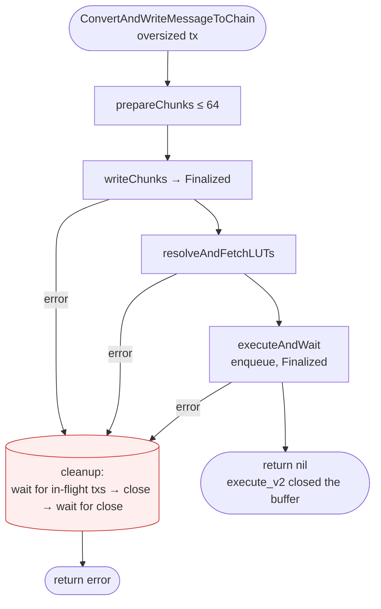

# Executor transmitter

Solana implementation of `chainaccess.ContractTransmitter` for the CCV executor.

## Overview

`SolanaContractTransmitter` takes a verified `protocol.AbstractAggregatedReport` from the CCV executor and submits an `execute_v2` transaction to the `ccip_offramp` program through the `chainlink-solana` `txm` (transaction manager).

A serialized Solana transaction, legacy or v0, is limited to **1232 bytes** (`PACKET_DATA_SIZE`).
Address lookup tables make a v0 transaction smaller, but they do not raise the limit.
The transmitter uses v0 transactions with lookup tables.
A CCIP message with its CCV data can be larger than this limit.
When the resolved `execute_v2` transaction is too large, the transmitter writes the execution inputs to an on-chain buffer first, then sends a smaller `execute_v2` that reads the buffer.
The buffer holds up to 64 chunks.

## Components

| File | Description |
| --- | --- |
| `transmitter.go` | `SolanaContractTransmitter`: input checks, execution inputs, inline or buffered routing |
| `buffer.go` | The synchronous buffered flow: chunk writes, account resolution, execution, error classification, and cleanup |
| `config.go` | Transmitter configuration and defaults |
| `keystore.go` | Loads the Solana transmitter key from the bootstrap keystore and adapts it to the signer and `core.Keystore` interfaces |

## Input checks

`ConvertAndWriteMessageToChain` rejects these messages before any RPC call. The error wraps `executor.ErrMessageRejectedByTransmitter`, so the executor does not retry the message.

| Check | Reason |
| --- | --- |
| `ExecutionGasLimit + CcipReceiveGasLimit == 0` | At a zero compute unit limit, `txm` omits the limit instruction, and the tx runs on the default budget. |
| A dest blob that `execute_v2` parses and cannot decode (`InvalidDestBlob`) | Every attempt fails. The offramp also logs a malformed blob in full, so a large blob can fill the log limit and hide the error. |
| More than 64 dest blob accounts for a message that calls the receiver (`TooManyMessagingAccounts`) | Every attempt fails. |
| A receiver that is not 32 bytes for a message that calls the receiver (`InvalidInputPubkeyBytes`) | Every attempt fails. |

`execute_v2` parses the dest blob when the message carries a token transfer, or when it calls the receiver: a non-empty, non-zero receiver with data or a receive gas limit (`is_offramp_token_only_transfer`).
`ccip.ValidateDestBlob` accepts exactly the blobs that the on-chain `SVMDestBlob::from_bytes` accepts.

A rejected message is never executed, and it leaves no on-chain trail. A manual execution fails with the same program error. To monitor these rejections, alert on the transmitter `Errorw` log "rejecting message that execute_v2 rejects on every attempt". The log has the fields `messageID`, `sourceChainSelector`, `sender` and `reason`. The executor also counts the rejection as an unrecoverable failure with the class `TransmitterRejected`, but without the reason.

## Inline path

The transmitter uses the inline path when the resolved tx is 1232 bytes or less.

```
ConvertAndWriteMessageToChain(report)
  ├─ input checks
  ├─ buildExecutionInputs (encode message + CCV data)
  ├─ ccip.ResolveExecAccounts(exec_inputs) → instruction + lookup tables
  ├─ GetLatestBlockhash, build tx
  ├─ calculateTxSizeInBytes → ≤ 1232: continue inline
  └─ txm.Enqueue(execute_v2) → return nil
```

The inline path returns `nil` when `txm` accepts the tx. `txm` rebroadcasts the same signed tx for a bounded time (`TxRetryTimeout`, `TxConfirmTimeout`) and does not sign it again with a new blockhash. This executor does not see an inline failure, so it does not retry the message. Other executors retry it on their own turn.

## Buffered path

### Trigger

Either condition sends the message to the buffered path:

1. The inline simulation tx is too large for the RPC. `isOversizedTxError` detects the "too large" error.
2. The simulation succeeds, but the resolved tx is larger than 1232 bytes.

`submitBuffered` runs synchronously on the caller's goroutine and returns its error. A returned error goes back to the CCV executor, which retries the message.

### Flow

```
submitBuffered
  ├─ newBufferedExecution: marshal ExecutionInputsV2, derive PDAs
  ├─ prepareChunks: split the payload (max 64 chunks, u64 bitmap)
  ├─ writeChunks: enqueue one buffer_execution_inputs tx per chunk in parallel,
  │               each with a new blockhash, then wait until each is Finalized
  ├─ resolveAndFetchLUTs: ccip.ResolveExecAccountsWithBuffer → execute_v2 ix + LUTs
  ├─ refreshBlockhash
  └─ executeAndWait: enqueue execute_v2 with the message's compute unit limit,
                     wait until Finalized
                     (execute_v2 closes the buffer on-chain)
```



### Buffer ID and PDA

- `buffer_id` is the CCIP message ID.
- The PDA seeds are `["execution_inputs_buffer", buffer_id, transmitter]`. The transmitter derives the PDA locally.
- The program does not require `buffer_id == message_id`. The transmitter sets them equal so that the PDA is deterministic.
- A retry by the same executor uses the same PDA. Other executors use other PDAs, because the seeds include the transmitter key.
- `buffer_execution_inputs` and `close_execution_inputs_buffer` take the `event_authority` and `program` accounts for Anchor CPI events.

### Finality

The transmitter waits for each buffer write to reach **Finalized**, not only confirmed, before it resolves accounts. This adds the finality latency, but `ResolveExecAccountsWithBuffer` then always sees the full buffer.

### Heap frame

The buffered `execute_v2` tx and the account resolution simulations include `RequestHeapFrame(256 * 1024)`. The offramp must be built with `custom-heap`, so its allocator uses the full 256 KB region. Without it, the default 32 KB bump allocator runs out of memory during CCV stage resolution for payloads above about 1 KB.

## Errors

### Terminal errors

These errors wrap `executor.ErrMessageRejectedByTransmitter`, so the executor does not retry the message:

| Error | Where the transmitter finds it |
| --- | --- |
| The input checks above | Before any RPC call |
| The payload needs more than 64 chunks | `prepareChunks`, before any write |
| `execute_v2` is still larger than 1232 bytes after buffering | `executeAndWait` |

The transmitter does not read program errors.
A program error is retryable.

### Retryable errors

All other errors are retryable.
This includes errors that depend on chain state, because a later retry can succeed: `UnsupportedTokenReceiverUseAsIsForPoolV1` (pool version), `TooManyAccountLocks` (resolved account set), and `MaxLoadedAccountsDataSizeExceeded` (account sizes).
It also includes token pool rate limits and RPC errors.
The transmitter does not simulate `execute_v2` before it sends it.
A program error usually lands as a failed tx, and the transmitter returns a retryable error.
The tx can also not land, because the `txm` simulation after the first broadcast stops further broadcasts.
When the error happens after the `InProgress` event, the failed tx is the on-chain trace of the attempt, and the message can be executed manually.
The destination reader caches the failed attempt, but it cannot simulate an oversized message, so it reports the attempt as not honest.
The upstream executor then lets only the first-ranked executor of the pool retry the message until it expires.
A failure before the first verify CPI leaves no CCV data in the tx, so the reader caches nothing, and every executor of the pool keeps retrying.

The sender controls up to 64 messaging accounts through the dest blob, so a sender can cause `TooManyAccountLocks` or `MaxLoadedAccountsDataSizeExceeded`.
The executor limits the rate: it retries a message at a fixed interval (pool size × `execution_interval`) until the message expires (`max_retry_duration`).
Each failed retry pays the chunk writes and the close, and the exec tx when it lands (about 5,000 lamports per tx with the default `txm` fees).
Its cleanup also waits until the blockhash of the failed exec tx expires (about 60 to 90 seconds), because `txm` reports a landed failure as `Fatal`.

### Cleanup after a failure

After the first chunk write, every failure goes through `cleanup`. A retry by this executor uses the same buffer PDA, so two races are possible:

- A buffer write that lands after the close creates the buffer again.
- A close that lands during a retry deletes the retry's buffer.

To prevent both, `cleanup` waits until no tx of the attempt can land, then closes the buffer, then waits until the close cannot land.
The rules for "cannot land" are in the comment on `stillInFlight` in `buffer.go`.

| Item | Value |
| --- | --- |
| Added latency | For a failed attempt with a tx that does not finalize, up to about 60 seconds (150 blocks) after the transmitter got that tx's blockhash. None for a successful attempt. |
| Bound | `buffered_flow_timeout`, or `buffer_cleanup_timeout` if the caller's context is already done |
| Bound expires first | The transmitter logs the txs that can still land and returns |

NOTE: If the bound expires first, or the process stops (`buffer_cleanup_timeout` is usually shorter than the wait), a write or the close can still land later. The next attempt of that message can then fail once:

- A buffer left by the earlier run already exists: the `txm` simulation of the first write fails (`BufferInvalidLength` or `BufferAlreadyContainsChunk`), so the write is not sent.
- A stale close deletes the buffer of the next attempt, or a stale write lands in it: the attempt fails at account resolution or lands a failed `execute_v2` tx.

In both cases, cleanup closes the buffer, and the executor retries the message. The rent goes back to the same fee payer.

## Lifecycle and shutdown

`txm` handles broadcast, rebroadcast, and commitment tracking for each enqueued tx. The buffered path blocks the caller for the duration of the flow, and the caller's context controls cancellation.

`NewSolanaContractTransmitter` starts `txm`. `Close()` is idempotent and does these steps:

1. Marks the transmitter closed, so that later `ConvertAndWriteMessageToChain` calls return `ErrTransmitterClosed`.
2. Closes `txm`.

`Close()` does not track in-flight buffered submissions. The caller's context (the executor shutdown) cancels them. The Solana accessor's `Close()` calls `Close()`.

## Configuration

Set these keys in the transmitter section of the local Solana configuration:

```toml
[chains."16423721717087811551".transmitter]
tx_retention_timeout = "30m"
```

| Key | Default | Description |
| --- | --- | --- |
| `tx_retention_timeout` | `4h` | How long `txm` keeps terminal tx status records. Must be at least `buffered_flow_timeout`, so finality polling can read them. |
| `buffered_flow_timeout` | `5m` | Bound for one buffered submission. Cleanup after a failure gets a new bound of the same length. |
| `buffer_cleanup_timeout` | `5s` | Bound for cleanup when the caller's context is already done (shutdown). |
| `tx_status_poll_interval` | `500ms` | How often the transmitter polls `txm` for tx status. |

An omitted or zero value uses the default. A negative value fails validation.

## Usage

```go
ct, err := transmitter.NewSolanaContractTransmitter(ctx, transmitter.Params{
    Lggr:          lggr,
    ChainSelector: protocol.ChainSelector(sel),
    ChainID:       "1337",
    RPC:           rpcClient,
    Keystore:      ks,
    KeyName:       transmitter.DefaultKeyName,
})
```

The transmitter key must have funds on the target chain. The key is the fee payer, the `execute_v2` signer, and the authority of the buffer PDAs. In the executor, the accessor gets the bootstrap keystore through the CCV `KeystoreRegistry`. `KeyName` is `transmitter.DefaultKeyName` unless `transmitter_key_name` is set for the destination chain.

## Tests

| File | Coverage |
| --- | --- |
| `keystore_test.go` | Key loading, signing, and the `core.Keystore` adapter |
| `buffer_test.go` | Chunking, the chunk limit, PDA derivation, tx size, a new blockhash per chunk, a failed exec tx that stays retryable, the wait for in-flight txs, and the cleanup order |
| `transmitter_test.go` | Canceled startup, encoding errors, the input checks, oversized tx detection, and the compute unit limit |
| `config_test.go` | Defaults, validation, and TOML decoding |
| `leak_test.go` | Goroutine leaks, `Close` idempotency, and rejection after `Close` |
| `integration-tests/transmitter` | The buffered flow against a local validator: a valid message, terminal dest blobs rejected before any write, failed exec txs that close the buffer, and a receiver revert that the destination reader caches but does not treat as honest |

Run the unit tests:

```sh
go test ./pkg/transmitter/...
```
